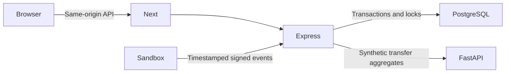
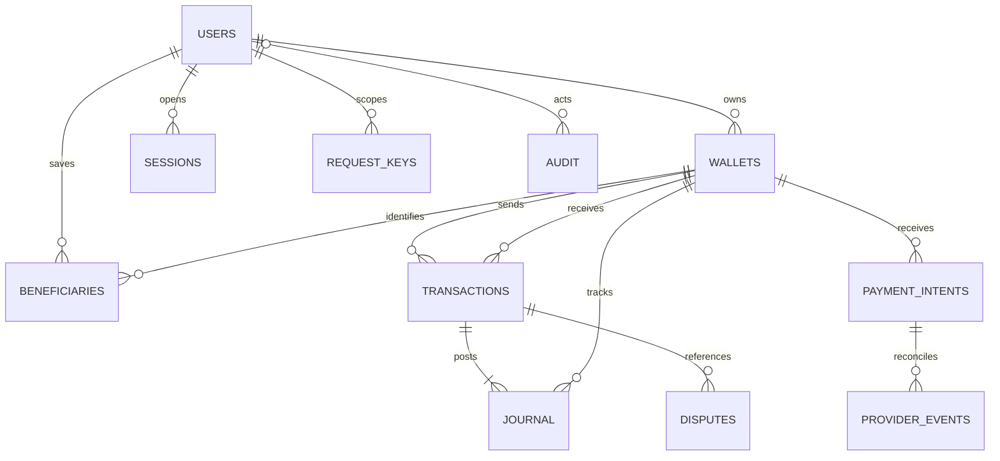
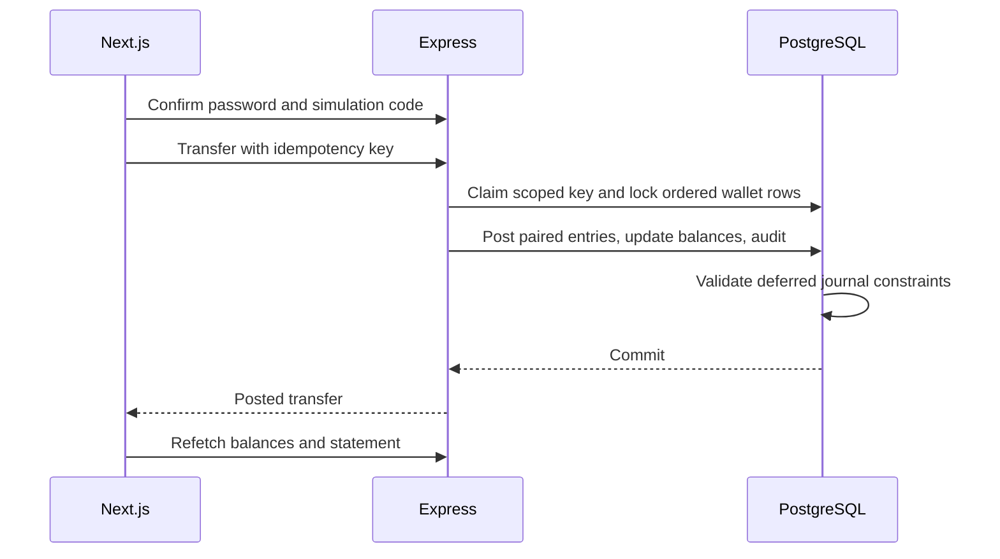

# Architecture and assessment coverage

Express owns identity, sessions, wallets, postings, payment intents, event receipts, disputes and audit history. FastAPI accepts bounded inputs and returns stateless calculations and signals. It receives internal wallet identifiers and aggregated transfer features.

## Financial rules

PostgreSQL bigint stores signed minor units. Every posting writes one negative and one positive journal entry for equal cents. A deferred database constraint requires both entries and validates their wallet and amount. Update and delete triggers protect posted records. The app updates cached wallet balances in the same transaction and locks both wallets in UUID order to prevent overspending and inconsistent lock ordering. A wallet can draw only up to its available balance. The simulation reserve is the system source of synthetic funding.

The request key is scoped to the authenticated user. A committed replay returns the saved response. Reuse with different operation parameters returns a conflict. The key, posting and saved response commit together. Payment intent transitions are pending to settled or failed. A mismatched provider amount is recorded and leaves the intent pending for investigation. Event IDs are unique across intents. The signature uses HMAC SHA-256 over timestamp, one period and the raw request body and expires after five minutes. A failed intent creates no posting. Refunds and reversals are separate compensating postings and every original posting may have at most one compensation.

Opaque session secrets are hashed in storage. Refresh atomically revokes the prior token. Privileged and money-moving actions require role or ownership checks, plus recent password and simulated code confirmation when applicable. Demo code is a simulation. Production-style setup requires real factor delivery or enrollment, rate limiting and a browser session hardening pass.

Statements sort by creation timestamp and transaction ID. The API accepts offset and limit, optional transaction type, and CSV export. CSV cells neutralize spreadsheet formula prefixes. FastAPI uses Decimal and ties-to-even rounding. Its risk threshold flags are for investigation and require human review.

## Evidence status by assessment

| Assessment | Local implementation and remaining evidence |
| --- | --- |
| 01 | Customer and staff workspaces with balance, transfers, recipients, statement export, disputes and operations views. |
| 02 | Express v1 endpoints with validation, request IDs, role checks and resource scoping. |
| 03 | PostgreSQL ledger, entries, triggers, intent state and audit. Separate holds and a versioned migration framework remain. |
| 04 | Password hashes, opaque sessions, rotation, revocation, simulated confirmation and scoped roles. |
| 05 | FastAPI fee, simple interest, statements and reconciliation using Decimal and ties-to-even rounding. |
| 06 | Risk flags for hourly transaction count and maximum transfer size. |
| 07 | Atomic postings, row locks, idempotent responses, event deduplication and compensations. |
| 08 | Local sandbox simulation and signature-verified webhook endpoint. External test provider and email/SMS sandbox integration remain. |
| 09 | Compose definitions for web, Express, FastAPI, PostgreSQL and Redis. Redis is provisioned for future jobs. Worker and Compose runtime evidence remain. |
| 10 | Suggested branch, reviewer and hotfix controls are in the deployment runbook. GitHub settings and review history remain. |
| 11 | Local workflow file defines test and source scans. Image scanning, signing, remote staging and run evidence remain. |
| 12 | Database-backed Supertest cases exercise overspending, replay, failed settlement, reversal and journal invariants. The local runner is Node's built-in test runner. The handbook's Jest or Vitest and React Testing Library requirements remain. |
| 13 | OpenAPI and Postman artifacts accompany the API. |
| 14 | Deployment and recovery runbook and a local restore drill are documented. Hosting, TLS, remote monitoring and encrypted backup evidence remain. |
| 15 | Automated incident scenarios exercise duplicate events, settlement mismatch, unbalanced posting, reversal and analytics timeout recovery. A live incident review remains. |
